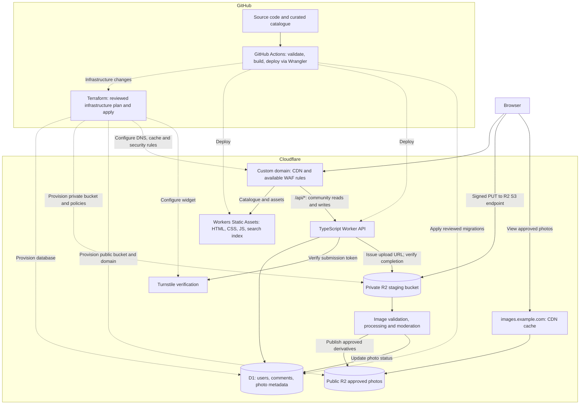

# VeloGroupsets

An open-source reference for bicycle groupsets and components, with community photos and comments.

VeloGroupsets aims to make component specifications and identification information easy to browse, search, and improve. Most traffic should be served as static content at Cloudflare's edge; a small API handles community contributions.

> **Status: planning.** This repository currently documents the proposed system. The application, infrastructure, and deployment workflows have not been implemented.

## Planned features

- Browse groupsets and individual components by manufacturer, model, generation, and component type.
- Search a static catalogue without making a database request for each search.
- View component specifications, source references, and community photos.
- Sign in to upload component photos and comment on photos.
- Report inappropriate content and support moderator approval, hiding, and removal.
- Improve curated catalogue data through GitHub pull requests.

Compatibility claims should identify their source and any limitations. Unknown information should stay explicitly unknown.

## Architecture

The starting design uses **Cloudflare Workers Static Assets + a TypeScript Worker + D1 + R2**, with Terraform managing Cloudflare infrastructure in this repository and GitHub Actions deploying the application through Wrangler. This keeps the initial stack small and aims to fit a modest community within free allowances.



The processing box describes a required capability; its runtime and trigger are still to be selected. It must not be assumed to fit within a free Worker's image-processing budget. `images.example.com` is an illustrative hostname, not a configured domain.

See [the architecture document](docs/architecture.md) for request flows, upload safeguards, caching, data ownership, and outstanding decisions.

### Responsibilities

| Area | Proposed implementation |
| --- | --- |
| Curated groupset and component data | Versioned JSON/YAML in GitHub, validated at build time |
| Catalogue pages and search | Generated HTML and a static search index |
| Community API | TypeScript Worker for reads, comments, upload authorization, and moderation |
| Community records | D1 for user references, comments, photo metadata, and moderation state |
| Original uploads | Private R2 staging bucket |
| Published photos | Approved image derivatives in a separate public R2 bucket, served through a custom domain |
| Abuse prevention | Server-validated Turnstile, authentication, per-user quotas, and rate limits |
| Infrastructure | Terraform in `infra/terraform/` for Cloudflare resources and settings |
| Delivery | GitHub Actions deploying trusted changes from `main` through Wrangler |

## Repository layout

This is the **planned** layout. Only the documentation and existing repository files are present today.

```text
velogroupsets/
├── apps/
│   ├── web/                 # Static site and frontend
│   └── api/                 # TypeScript Worker API
├── data/
│   ├── groupsets/           # Curated catalogue records
│   └── components/
├── packages/
│   └── shared/              # Shared types and validation
├── db/
│   └── migrations/          # D1 schema migrations
├── infra/
│   └── terraform/           # Cloudflare resources, settings, and environment inputs
├── scripts/                 # Data checks and build helpers
├── docs/
│   └── architecture.md
├── .github/
│   └── workflows/           # Validation and deployment
├── AGENTS.md
├── LICENSE
└── README.md
```

Keep one repository initially so catalogue, frontend, and API changes can be reviewed together. User accounts, comments, uploads, database exports, and credentials belong outside Git.

## Local development

There is no runnable application or package setup yet. Clone the repository to work on the documentation:

```sh
git clone https://github.com/drewfreyling/velogroupsets.git
cd velogroupsets
```

The application scaffold will add pinned runtime/tool versions, dependency installation, development commands, local D1/R2 setup, and example environment variables. Build and test commands will be documented when they exist.

## Infrastructure ownership

Keep Terraform alongside the application in `infra/terraform/` so infrastructure and code changes can be reviewed together.

| Owner | Scope |
| --- | --- |
| Terraform | D1 databases, R2 buckets and their CORS/lifecycle/public-domain settings, DNS, zone cache/WAF rules supported by the plan/provider, Turnstile widgets, and explicitly assigned route/domain resources |
| Wrangler + GitHub Actions | Worker definition and code, static assets, runtime bindings/configuration, and application deployment |
| Database migration tooling | D1 tables, indexes, and schema changes in `db/migrations/` |

Each resource or setting must have one owner. Terraform provisions databases/buckets; Wrangler references their IDs/names as bindings. Keep Terraform state in a secured remote backend with locking, separate staging and production state, and no state or credentials in Git. Commit the Terraform dependency lock file and only non-secret environment inputs. The backend and bootstrap procedure remain to be selected.

See [infrastructure and deployment](docs/architecture.md#infrastructure-and-deployment) for the proposed Terraform layout, ownership boundaries, imports, and plan/apply workflow.

## Deployment plan

1. Validate catalogue records and application changes; format and validate Terraform changes. Run plans only in trusted workflows with appropriately scoped credentials.
2. Review an environment-specific Terraform plan and apply that exact plan through the protected production workflow when infrastructure changes are required. Import existing resources before managing them.
3. Build static pages, assets, and a search index; deploy previews using isolated development resources and no production secrets.
4. Pass provisioned resource IDs/names into Wrangler bindings. Apply reviewed, backward-compatible migrations in the required order and deploy trusted application changes from `main` through Wrangler.
5. Verify the deployment, community API, and static routing.

Use explicit `/api/*` routing so API requests cannot fall through to static pages. Untrusted fork pull requests must not receive deployment credentials or access to production data. Prefer migrations compatible with both old and new application versions; an application rollback does not reverse database changes.

## Cost approach

The goal is low ongoing cost, not an unconditional promise of free hosting. Domain registration and renewal remain separate costs.

Indicative Cloudflare allowances checked on **7 November 2026**:

| Service | Included free usage |
| --- | --- |
| Workers Static Assets | Free, unlimited requests served directly as static assets; platform file limits apply |
| Workers API | 100,000 requests per day and 10 ms CPU time per invocation |
| D1 | 5 million rows read/day, 100,000 rows written/day, 5 GB total storage; 500 MB maximum per database on Free |
| R2 Standard | 10 GB-month storage, 1 million Class A operations/month, 10 million Class B operations/month; no egress bandwidth fees |

D1 usage counts rows scanned/written, not just API calls. Add indexes and pagination. Image originals, derivatives, and abandoned uploads all consume storage.

Free-plan limits can cause requests or queries to fail. R2 and paid services can accrue usage charges. Budget alerts are notifications, not a hard spending cap: enforce upload quotas, size limits, cleanup policies, and usage monitoring in the application. Image processing, identity-provider features, and enhanced security features need their own pricing checks.

Official references: [static assets](https://developers.cloudflare.com/workers/static-assets/billing-and-limitations/), [Workers pricing](https://developers.cloudflare.com/workers/platform/pricing/), [D1 pricing](https://developers.cloudflare.com/d1/platform/pricing/), [D1 limits](https://developers.cloudflare.com/d1/platform/limits/), and [R2 pricing](https://developers.cloudflare.com/r2/pricing/).

## Contributing

Issues and pull requests are welcome for catalogue corrections, source references, documentation, and implementation work.

- Use stable component and groupset IDs; a display-name or URL change must not detach existing community content.
- Include sources for specifications and distinguish documented facts from estimates.
- Submit only material you have permission to contribute. Do not copy manufacturer images or manuals without checking their terms.
- Keep real user data and secrets out of examples and fixtures.
- Update documentation when behaviour or architecture changes.

**All commits must follow [Conventional Commits](https://www.conventionalcommits.org/en/v1.0.0/).** Use the same format for pull request titles so squash merges remain compliant.

Examples:

```text
feat(catalogue): add groupset browsing
fix(api): reject comments on removed photos
docs(architecture): document direct R2 uploads
data(components): add sourced derailleur specifications
chore(ci): validate catalogue references
```

Use `!` and/or a `BREAKING CHANGE:` footer for breaking changes. See [AGENTS.md](AGENTS.md) for repository instructions for coding agents.

## Initial milestones

- [ ] Define catalogue schemas, stable IDs, and source attribution.
- [ ] Scaffold the static frontend, Worker, and shared validation.
- [ ] Add catalogue generation and client-side search.
- [ ] Select authentication and implement sessions and authorization.
- [ ] Add D1 migrations and paginated public community reads.
- [ ] Implement private uploads, image processing, and moderation.
- [ ] Add photo comments, reporting, and contributor quotas.
- [ ] Select and bootstrap a locked remote Terraform backend with separate staging/production state.
- [ ] Define Terraform-managed Cloudflare resources and import existing resources as needed.
- [ ] Configure CI plans/applies, isolated previews, custom domains, and Wrangler production deployment.
- [ ] Establish backup, restore, deletion, and usage-monitoring procedures.
- [ ] Finalize catalogue licensing and user contribution/photo terms before accepting uploads.

## License

Project code is licensed under [GNU GPL v3.0](LICENSE). A dedicated catalogue-data policy and user-photo contribution terms remain to be defined; do not assume the code licence grants rights to third-party content.
