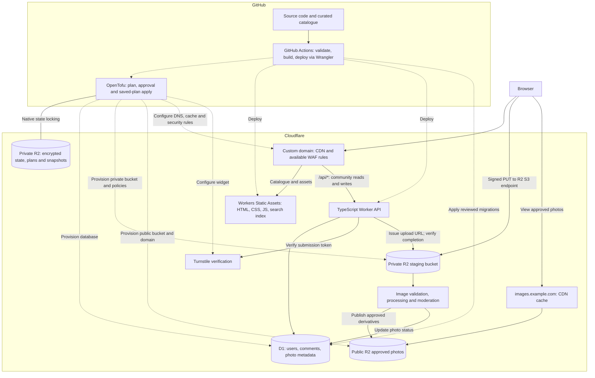
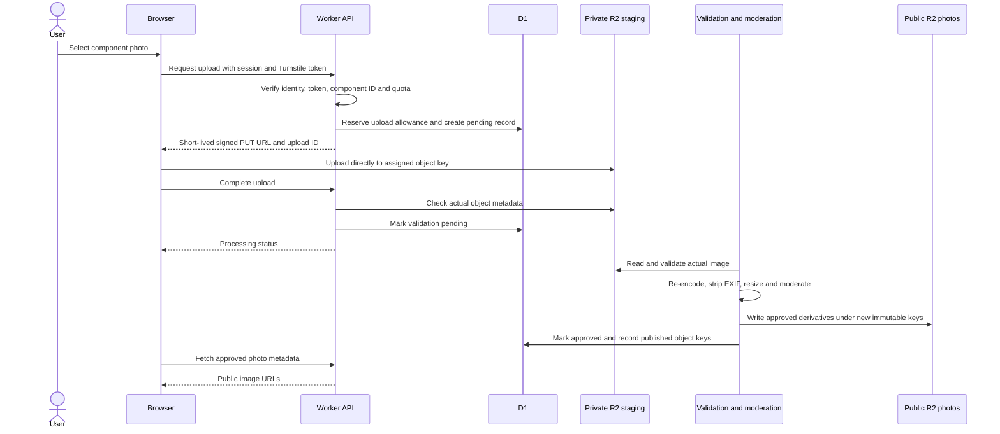

# Architecture

**Status:** initial OpenTofu, CI and catalogue schemas/validation are implemented; The staging D1/R2/Turnstile foundation was [provisioned on 7 November 2026](https://github.com/drewfreyling/velogroupsets/actions/runs/42334477273); production deployment remains pending. Astro/Tailwind catalogue pages, browser search, a TypeScript Worker health endpoint and a manual Wrangler deployment workflow are implemented. The first app deployment/custom-domain activation is pending; community features remain planned. See [the infrastructure guide](../infra/README.md) for the implemented scope and bootstrap steps.

## Goals and starting decisions

Serve a mostly read-only bicycle groupset catalogue quickly, keep operating costs low, and allow authenticated users to upload component photos and comment on photos.

Use one GitHub repository for code, curated catalogue data, database migrations, and infrastructure configuration. Use a TypeScript Worker and D1, with OpenTofu in `infra/opentofu/` provisioning Cloudflare resources and Wrangler deploying the application. Catalogue browsing should continue to work if community services reach a quota or become unavailable.

## System diagram

The diagram is logical, not a deployment manifest. WAF capabilities depend on the Cloudflare plan. Turnstile is a browser widget with backend verification, not a universal network filter. Direct signed uploads go to the R2 S3 endpoint and must not rely on the site's WAF rules for protection.

The image-processing runtime and trigger are unresolved. The processor may need a separately priced service or compute budget. Photo uploads must remain disabled until validation, publication, and cleanup work end to end.

## UI and catalogue model

Astro generates static HTML and compiles Tailwind CSS into the frontend bundle. The UI browses manufacturer → groupset → component, with breadcrumbs and component-type filtering. Manufacturers, groupsets and canonical component pages are generated at build time. Search and type/groupset filters run in the browser; no database is used for catalogue reads.

Curated records are JSON files in `data/manufacturers/`, `data/groupsets/`, and `data/components/`. Groupsets reference a manufacturer ID; components reference a manufacturer ID and one or more groupset IDs. References preserve one component identity and photo/comment history when shared across groupsets. Catalogue IDs are stable and separate from slugs/display names. Manufacturer here means the catalogue brand, not necessarily the physical factory.

The initial taxonomy is Crankset, Bottom Bracket, Front Derailleur, Rear Derailleur, Shifters, Cassettes, Headset, Seatpost, Pedals, Front Hub, and Rear Hub. A groupset need not contain every category; absence of a record means not yet catalogued. Membership and specifications need sources.

See [the catalogue and UI guide](catalogue.md) for schemas, stable type IDs, examples, and validation rules. CI now validates record structure, source formatting, IDs, slugs, filenames, and references offline; the starter Shimano 105 R7000 records and static build now exercise the hierarchy end to end.

## Catalogue reads

1. A contributor changes JSON catalogue records through a pull request.
2. CI validates record schemas, stable IDs, relationships, and source citation structure. Evidence accuracy and source availability remain review responsibilities.
3. The build generates HTML, static catalogue data, and a client-side search index.
4. Cloudflare serves the generated site without querying D1 for normal catalogue navigation.

Use a stable ID for each component and groupset, separate from its URL slug and display name. Removing or renaming a catalogue record needs a policy for redirects and existing community references. The API must validate submitted component IDs against a catalogue ID set shipped with its deployment.

## Community reads and writes

The Worker serves both public reads and authenticated writes. Illustrative routes:

| Route | Responsibility |
| --- | --- |
| `GET /api/components/:id/photos` | Paginated list of approved photo metadata |
| `GET /api/photos/:id/comments` | Paginated list of visible photo comments |
| `POST /api/photos/:id/comments` | Authorized, validated comment submission |
| `POST /api/uploads` | Reserve quota, create pending record, issue signed URL |
| `POST /api/uploads/:id/complete` | Verify ownership and uploaded object, schedule validation |
| Moderator-only routes | Approve, hide, remove, and review reports |

Routes are proposals, not an implemented API contract. Requests that edit or delete content must check ownership or moderator permissions. Hidden photos and comments must not leak through public APIs.

D1 stores identity-provider references, user roles, comments, photo metadata, upload reservations, reports, and moderation status. Store image object keys in D1, not image bytes or expiring signed URLs. Authentication provider and session design are still to be chosen; visitors do not need accounts to browse public content.

Use parameterized SQL, indexes, bounded queries, and pagination. API writes should be retry-safe where duplicate submissions are possible.

## Upload and publication flow

Required safeguards:

- Require authentication and server-side Turnstile verification when authorizing submissions. Check the expected hostname/action. Turnstile does not replace authorization.
- Generate unpredictable object keys on the server. Bind each upload to its owner, component, expiry, and reserved quota.
- Sign only the required operation and object key, with a short expiry and expected content type. Signed URLs are bearer capabilities and can be reused until expiry; do not treat them as one-time credentials.
- Configure staging-bucket CORS for the site's origin and required methods/headers. CORS is a browser policy, not access control against other clients.
- Treat declared size, MIME type, and browser checks as untrusted. Verify actual uploaded size, decode the image, and enforce format, pixel-count, and processing-resource limits. Reject active content such as SVG initially.
- A signed PUT alone is not a sufficient maximum-size enforcement mechanism. Define a separate approach if strict ingress size enforcement is needed; otherwise account for temporary oversized objects and reject/delete them before publication.
- Publish from validated bytes to a new key in a separate bucket. Never expose staging keys directly: a still-valid signed URL could overwrite an uploaded original after validation.
- Re-encode approved images, remove EXIF/GPS metadata, and generate bounded display sizes before public release.
- Keep rejected uploads private; expire abandoned objects and reservations, and handle retries without publishing duplicates.
- Make publication state transitions recoverable: D1 updates and R2 writes are not one cross-service transaction. Reconcile orphaned objects and records after failures.

A private staging bucket and a public approved bucket are a security boundary. Attaching a public custom domain to the staging bucket would defeat that boundary.

References: [R2 presigned URLs](https://developers.cloudflare.com/r2/api/s3/presigned-urls/), [R2 CORS](https://developers.cloudflare.com/r2/buckets/cors/), and [Turnstile validation](https://developers.cloudflare.com/turnstile/get-started/server-side-validation/).

## Caching and routing

| Content | Policy |
| --- | --- |
| Catalogue HTML | Static serving; refresh on deploy and use appropriate browser revalidation |
| Hashed JS/CSS and versioned catalogue/search files | Long-lived immutable caching |
| Approved photo derivatives | Long-lived caching through an R2 custom domain; use new keys when bytes change |
| Public photo/comment lists | Explicit short shared cache, initially 30–60 seconds |
| Sessions, upload URLs, private/moderator responses, writes | `Cache-Control: no-store`; no shared caching |

Configure public API caching explicitly. A general Cloudflare proxy does not cache HTML or JSON by default, and a cache lookup inside a Worker still invokes the Worker. Do not assume a cached API response eliminates Worker request accounting.

Keep personalized information out of public cached responses. Skip shared caching for authenticated requests initially, and never cache a response containing session cookies or a signed upload URL.

The public image bucket should use a custom domain such as `images.example.com`; `r2.dev` is for development and is not the production caching path. Presigned upload URLs use `<ACCOUNT_ID>.r2.cloudflarestorage.com`, not the public image domain.

On comment/photo moderation or deletion, invalidate affected API caches and purge public image URLs as applicable. Long cache lifetimes require an explicit removal procedure; deleting an origin object alone does not immediately remove cached copies.

References: [default CDN cache behaviour](https://developers.cloudflare.com/cache/concepts/default-cache-behavior/) and [R2 caching](https://developers.cloudflare.com/cache/interaction-cloudflare-products/r2/).

## Security and operations

- Keep secrets in deployment/runtime secret stores. Grant CI and R2 credentials only the permissions needed.
- Separate preview and production D1 databases, R2 buckets, identity settings, and credentials. Fork PR checks run without production secrets.
- Validate comment length and render comments as escaped text or safely sanitized markup.
- Protect cookie-authenticated writes against CSRF and enforce restrictive session-cookie settings.
- Apply per-user upload/storage/comment quotas and appropriate IP rate limits. Use application checks alongside the available WAF features.
- Record moderation actions, provide reporting, and define account/content deletion procedures.
- Back up D1 with a documented retention and restore process; test restoration. Define retention and recovery needs for R2 originals and published derivatives separately.
- Track usage, failed requests, pending-upload age, processor failures, and storage growth. Avoid logging secrets, session tokens, or signed URLs.
- Degrade community widgets gracefully when the API is unavailable, preserving static catalogue browsing.

## Infrastructure and deployment

OpenTofu configuration lives in `infra/opentofu/`, with separate environment inputs and R2 backend keys. GitHub Actions runs the pinned CLI; no external infrastructure-execution service is required. See [the infrastructure guide](../infra/README.md) for setup, credentials, commands, recovery, and the implemented scope.

| Owner | Scope |
| --- | --- |
| OpenTofu | D1, application R2 buckets/CORS/lifecycle/public-domain settings, Turnstile and opt-in website custom domains; future cache/WAF rules |
| Wrangler + GitHub Actions | Worker definition/code, static assets, bindings, runtime configuration and secret injection |
| Database migrations | D1 tables, indexes and schema changes |
| Independent bootstrap | Dedicated private R2 state bucket and its retention/access settings |

The state bucket cannot depend on its own state. Create it first, keep it private, and never apply temporary-upload lifecycle rules to it. State uses `state/staging/terraform.tfstate` and `state/production/terraform.tfstate`, with native S3 lockfiles enabled. Both prefixes share a bucket; separate buckets and scoped credentials are needed if stronger environment isolation is required.

### State, encryption and locking

OpenTofu enforces encryption of state and saved plans. The runner receives a separate securely backed-up encryption key for each environment. Neither keys nor plaintext plans/state go into Git or GitHub artifacts. Immutable encrypted recovery snapshots are stored before plans/applies and after applies. Maintain independent recovery copies: snapshots in the same bucket cannot survive deletion of that bucket, and losing the encryption key makes them unreadable.

Every live plan/apply first probes actual lock contention and release using an isolated R2 state key and the pinned OpenTofu CLI. It must pass before touching application state. Local CI exercises the same mechanism with a local backend and checks encrypted state/plan output; it does not prove live R2 compatibility. Conditional-write retries/network failures can still leave orphaned locks. Investigate stale locks and confirm all writers have stopped before any targeted force-unlock; never automatically remove real locks or run with locking disabled.

### Review and releases

1. Credential-free CI validates Conventional Commits and PR titles, docs, workflows, automation, OpenTofu configuration, mocked resource policies, and a real local locking/encryption probe.
2. A manual infrastructure workflow runs from `main`. Its plan job uses `<environment>-plan` credentials to verify R2 locking, snapshot existing state, generate an encrypted plan and save it privately in R2.
3. The public job summary exposes only source commit, checksum and resource addresses/actions. Review detailed values privately using the encrypted plan and the secured decryption key.
4. A plan-and-apply run waits for the `staging` or `production` environment approval. The apply script fails closed if required reviewers are absent or the policy cannot be read.
5. Apply verifies the commit/run/environment binding and saved plan checksum, checks locking, snapshots state, and applies the exact plan. It never silently replans. A state change makes the plan stale and requires a new run.
6. Workflow concurrency spans plan, approval and apply; backend locking protects against other writers. Future application deployments must use compatible release coordination. Back up application data before schema changes and keep schemas compatible across application versions.

Inventory/import existing resources before adopting them. Persistent D1/R2 resources use destruction protection, which does not survive removing their resource blocks. Several R2 settings resources in the pinned provider cannot be imported; inspect and reconcile them explicitly. State recovery is not database/object-data recovery.

The implemented foundation defines D1, private-by-default R2 buckets/policies, Turnstile, and opt-in image-domain access. It also defines an opt-in website custom domain targeting an existing Wrangler-created Worker; Cloudflare creates its DNS record and TLS certificate. Activate it only after the first Worker deploy. The manual website workflow reads existing bindings from encrypted state and shares the infrastructure release lock and required-reviewer policy. Cache/WAF rules and application database schema remain planned. Assign each setting one owner. Avoid independent rulesets for the same phase/zone across environments; avoid declaring Wrangler-owned Worker deployments in OpenTofu.

## Cost and portability

The initial design aims to use Cloudflare free allowances; see the [README cost table](../README.md#cost-approach) and linked official pricing. Those allowances do not cover unlimited storage, processing, or enhanced security features. Quota exhaustion can interrupt community features, and budget alerts do not enforce a spending cap.

D1 uses SQLite semantics. Versioned JSON catalogue records, SQL migrations, and an explicit storage interface help portability; changing database providers would still require reviewing schema and query behaviour.

## Decisions required before community launch

- Frontend/static generator, package manager, runtime versions, and local development commands.
- Authentication provider, sessions, account recovery, and moderator provisioning.
- Image-processing runtime, triggering/retry mechanism, and resource/cost limits.
- Supported image formats, byte/pixel limits, quota values, and retention periods.
- Moderation policy, reporting, privacy/deletion policy, and user-photo permissions.
- Populate sourced catalogue records, refine type-specific specifications, and finalize dedicated data licensing.
- Configure production GitHub environments and complete the reviewed production apply. Staging state storage, live locking and the reviewed foundation apply are complete.
- Website DNS/Worker route ownership and targets, image-domain activation, and application deployment coordination.
