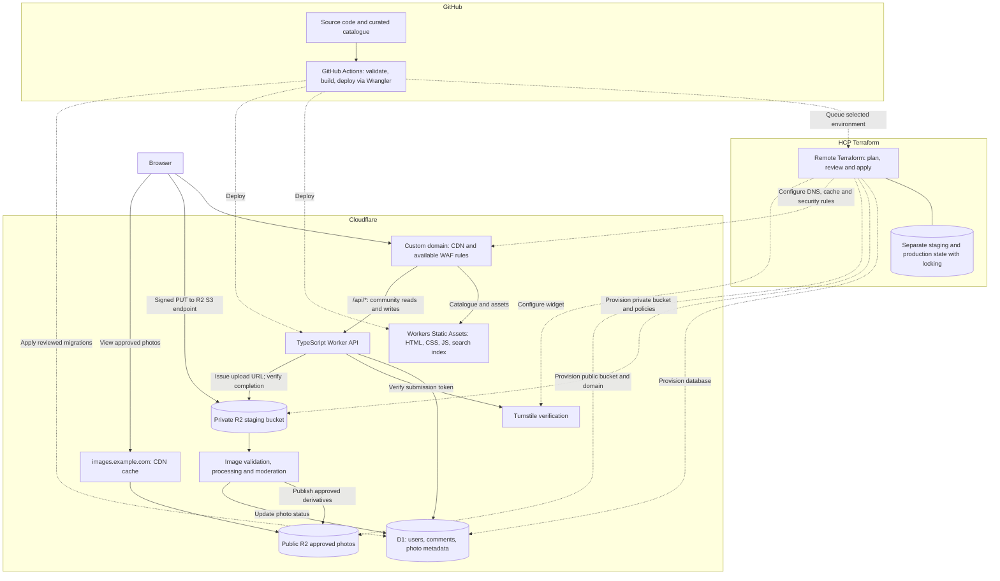
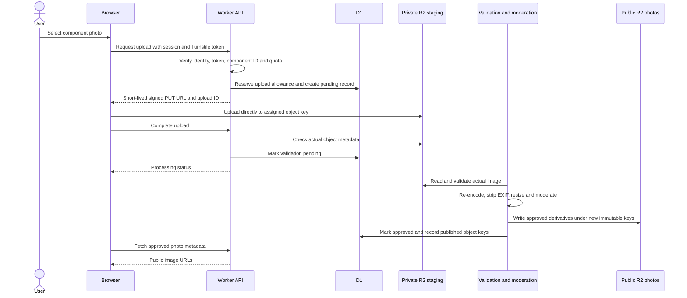

# Architecture

**Status:** initial Terraform and CI are implemented; Cloudflare resources have not yet been provisioned. Application components and Wrangler deployment remain planned. See [the infrastructure guide](../infra/README.md) for the implemented scope and bootstrap steps.

## Goals and starting decisions

Serve a mostly read-only bicycle groupset catalogue quickly, keep operating costs low, and allow authenticated users to upload component photos and comment on photos.

Use one GitHub repository for code, curated catalogue data, database migrations, and infrastructure configuration. Use a TypeScript Worker and D1, with Terraform in `infra/terraform/` provisioning Cloudflare resources and Wrangler deploying the application. Catalogue browsing should continue to work if community services reach a quota or become unavailable.

## System diagram



The diagram is logical, not a deployment manifest. WAF capabilities depend on the Cloudflare plan. Turnstile is a browser widget with backend verification, not a universal network filter. Direct signed uploads go to the R2 S3 endpoint and must not rely on the site's WAF rules for protection.

The image-processing runtime and trigger are unresolved. The processor may need a separately priced service or compute budget. Photo uploads must remain disabled until validation, publication, and cleanup work end to end.

## Catalogue reads

1. A contributor changes JSON/YAML catalogue records through a pull request.
2. CI validates records, stable IDs, relationships, and sources.
3. The build generates HTML, static catalogue data, and a client-side search index.
4. Cloudflare serves the generated site without querying D1 for normal catalogue navigation.

Use a stable ID for each component and groupset, separate from its URL slug and display name. Removing or renaming a catalogue record needs a policy for redirects and existing community references. The API must validate submitted component IDs against a catalogue ID set shipped with its deployment.

## Community reads and writes

The Worker serves both public reads and authenticated writes. Illustrative routes:

| Route | Responsibility |
| --- | --- |
| `GET /api/components/:id/photos` | Paginated list of approved photo metadata |
| `GET /api/photos/:id/comments` | Paginated list of visible photo comments |
| `POST /api/photos/:id/comments` | Authorized, validated comment submission |
| `POST /api/uploads` | Reserve quota, create pending record, issue signed URL |
| `POST /api/uploads/:id/complete` | Verify ownership and uploaded object, schedule validation |
| Moderator-only routes | Approve, hide, remove, and review reports |

Routes are proposals, not an implemented API contract. Requests that edit or delete content must check ownership or moderator permissions. Hidden photos and comments must not leak through public APIs.

D1 stores identity-provider references, user roles, comments, photo metadata, upload reservations, reports, and moderation status. Store image object keys in D1, not image bytes or expiring signed URLs. Authentication provider and session design are still to be chosen; visitors do not need accounts to browse public content.

Use parameterized SQL, indexes, bounded queries, and pagination. API writes should be retry-safe where duplicate submissions are possible.

## Upload and publication flow



Required safeguards:

- Require authentication and server-side Turnstile verification when authorizing submissions. Check the expected hostname/action. Turnstile does not replace authorization.
- Generate unpredictable object keys on the server. Bind each upload to its owner, component, expiry, and reserved quota.
- Sign only the required operation and object key, with a short expiry and expected content type. Signed URLs are bearer capabilities and can be reused until expiry; do not treat them as one-time credentials.
- Configure staging-bucket CORS for the site's origin and required methods/headers. CORS is a browser policy, not access control against other clients.
- Treat declared size, MIME type, and browser checks as untrusted. Verify actual uploaded size, decode the image, and enforce format, pixel-count, and processing-resource limits. Reject active content such as SVG initially.
- A signed PUT alone is not a sufficient maximum-size enforcement mechanism. Define a separate approach if strict ingress size enforcement is needed; otherwise account for temporary oversized objects and reject/delete them before publication.
- Publish from validated bytes to a new key in a separate bucket. Never expose staging keys directly: a still-valid signed URL could overwrite an uploaded original after validation.
- Re-encode approved images, remove EXIF/GPS metadata, and generate bounded display sizes before public release.
- Keep rejected uploads private; expire abandoned objects and reservations, and handle retries without publishing duplicates.
- Make publication state transitions recoverable: D1 updates and R2 writes are not one cross-service transaction. Reconcile orphaned objects and records after failures.

A private staging bucket and a public approved bucket are a security boundary. Attaching a public custom domain to the staging bucket would defeat that boundary.

References: [R2 presigned URLs](https://developers.cloudflare.com/r2/api/s3/presigned-urls/), [R2 CORS](https://developers.cloudflare.com/r2/buckets/cors/), and [Turnstile validation](https://developers.cloudflare.com/turnstile/get-started/server-side-validation/).

## Caching and routing

| Content | Policy |
| --- | --- |
| Catalogue HTML | Static serving; refresh on deploy and use appropriate browser revalidation |
| Hashed JS/CSS and versioned catalogue/search files | Long-lived immutable caching |
| Approved photo derivatives | Long-lived caching through an R2 custom domain; use new keys when bytes change |
| Public photo/comment lists | Explicit short shared cache, initially 30–60 seconds |
| Sessions, upload URLs, private/moderator responses, writes | `Cache-Control: no-store`; no shared caching |

Configure public API caching explicitly. A general Cloudflare proxy does not cache HTML or JSON by default, and a cache lookup inside a Worker still invokes the Worker. Do not assume a cached API response eliminates Worker request accounting.

Keep personalized information out of public cached responses. Skip shared caching for authenticated requests initially, and never cache a response containing session cookies or a signed upload URL.

The public image bucket should use a custom domain such as `images.example.com`; `r2.dev` is for development and is not the production caching path. Presigned upload URLs use `<ACCOUNT_ID>.r2.cloudflarestorage.com`, not the public image domain.

On comment/photo moderation or deletion, invalidate affected API caches and purge public image URLs as applicable. Long cache lifetimes require an explicit removal procedure; deleting an origin object alone does not immediately remove cached copies.

References: [default CDN cache behaviour](https://developers.cloudflare.com/cache/concepts/default-cache-behavior/) and [R2 caching](https://developers.cloudflare.com/cache/interaction-cloudflare-products/r2/).

## Security and operations

- Keep secrets in deployment/runtime secret stores. Grant CI and R2 credentials only the permissions needed.
- Separate preview and production D1 databases, R2 buckets, identity settings, and credentials. Fork PR checks run without production secrets.
- Validate comment length and render comments as escaped text or safely sanitized markup.
- Protect cookie-authenticated writes against CSRF and enforce restrictive session-cookie settings.
- Apply per-user upload/storage/comment quotas and appropriate IP rate limits. Use application checks alongside the available WAF features.
- Record moderation actions, provide reporting, and define account/content deletion procedures.
- Back up D1 with a documented retention and restore process; test restoration. Define retention and recovery needs for R2 originals and published derivatives separately.
- Track usage, failed requests, pending-upload age, processor failures, and storage growth. Avoid logging secrets, session tokens, or signed URLs.
- Degrade community widgets gracefully when the API is unavailable, preserving static catalogue browsing.

## Infrastructure and deployment

### Location and ownership

Keep infrastructure in this application repository under `infra/terraform/`. It has the same review and release context as the application. A separate repository is only needed if shared infrastructure or separate ownership later requires it.

Implemented Terraform layout:

```text
infra/
└── terraform/
    ├── main.tf
    ├── variables.tf
    ├── outputs.tf
    ├── versions.tf
    ├── .terraform.lock.hcl
    ├── tests/
    │   └── foundation.tftest.hcl
    └── environments/
        ├── staging.tfvars
        └── production.tfvars
```

Use shared Terraform configuration with non-secret environment inputs and separate API-driven HCP Terraform workspaces for staging and production. HCP runs Terraform remotely, stores state, locks each workspace, and requires explicit approval to apply. The initial configuration provisions D1, private-by-default R2 buckets/policies, and Turnstile. Photo-domain publication is opt-in; website DNS/routes and cache/WAF rules remain planned. Bootstrap instructions and credentials are documented in [infra/README.md](../infra/README.md).

| Owner | Resources and settings |
| --- | --- |
| Terraform | D1 database resources; R2 buckets, CORS, lifecycle rules, public access and approved-photo custom-domain configuration; DNS records; zone cache rules and WAF rules supported by the selected plan/provider; Turnstile widgets; explicitly assigned Worker route/domain resources |
| Wrangler + GitHub Actions | Worker definition and code, static assets, compatibility settings, runtime bindings/configuration, application releases, and runtime-secret injection |
| Database migration tooling | D1 tables, indexes, and schema changes under `db/migrations/` |

Give every resource and setting one owner. Do not also declare the Worker deployment in Terraform or let Wrangler create databases/buckets already owned by Terraform. Terraform outputs expose only the non-secret IDs/names needed for Wrangler bindings. Bindings remain application configuration; changing a binding does not transfer ownership of its target resource.

Terraform owns R2 CORS/lifecycle settings and zone cache rules; application response headers and API cache logic remain in Worker code. Assign route/domain resources explicitly during scaffolding: a Terraform-owned route must not also be configured for Wrangler to create or update automatically. Where a route references a Worker, create the Worker first and then apply the route, with subsequent deployments respecting that ownership.

Keep runtime secret values and deployment tokens in the appropriate secret stores. Avoid passing them through Terraform unless a resource requires it; any required secret can still enter state. Document how the Turnstile secret is delivered securely to the Worker without logging it or exposing it through public outputs.

### State and existing resources

- HCP Terraform supplies secured remote state and workspace locking. Bootstrap two separate remote-execution workspaces and disable auto-apply before queueing runs.
- Keep staging and production in separate state locations with explicit backend selection and narrowly scoped access. Environment `.tfvars` files alone do not separate state.
- Bootstrap the backend independently of the state it stores, and document recovery and access setup.
- Keep state files, state backups, saved plan files, backend credentials, provider credentials, and `.terraform/` out of Git. Commit `.terraform.lock.hcl` and non-secret inputs; pin Terraform/provider versions.
- Treat state and saved plans as sensitive. Protect backend storage, restrict CI artifacts and their retention, and establish state recovery procedures.
- Inventory and import existing Cloudflare resources, especially DNS records, before making Terraform authoritative. Review the first plan for unexpected changes or deletions.
- Protect persistent D1/R2 resources against accidental destruction where supported. Intentional deletion needs a reviewed migration/retention plan; infrastructure rollback is not data recovery.

### Review and deployment workflow

GitHub Actions should validate and build pull requests, then deploy trusted changes from `main`.

1. Run catalogue/application checks and Terraform formatting/validation for relevant changes. Untrusted fork checks receive no infrastructure credentials, backend state, or production access.
2. Generate Terraform plans only in trusted workflows with narrowly scoped credentials and the explicit target environment. Review changes before applying.
3. Use the manual GitHub infrastructure workflow to queue a speculative plan or an apply-capable plan in HCP. Auto-apply is disabled; review and explicitly approve the exact apply-capable plan in HCP. GitHub job success means submission, not remote plan/apply success. HCP serializes Terraform runs; application deployment coordination must wait for the remote run to finish, because GitHub submission concurrency ends when the run is queued.
4. Use provisioned D1 IDs and R2 names in Wrangler configuration. Bootstrap the Worker before any dependent route/domain resources, as required by the ownership assignment.
5. Back up before schema changes as appropriate, apply reviewed backward-compatible D1 migrations in the documented order, and deploy Worker code/static assets through Wrangler.
6. Verify static routing, API behaviour, bindings, and public image delivery. Configure previews independently and verify secrets never reach frontend bundles.

Configure static assets so catalogue requests avoid unnecessary Worker execution and `/api/*` always reaches the API. Select the exact Worker/static-assets packaging during scaffolding.

A Git push is not a database backup or a reverse migration. Application rollback does not reverse schema or infrastructure changes. Keep application and schema changes compatible across deployment boundaries and establish recovery procedures before production changes.

## Cost and portability

The initial design aims to use Cloudflare free allowances; see the [README cost table](../README.md#cost-approach) and linked official pricing. Those allowances do not cover unlimited storage, processing, or enhanced security features. Quota exhaustion can interrupt community features, and budget alerts do not enforce a spending cap.

D1 uses SQLite semantics. Versioned JSON/YAML catalogue records, SQL migrations, and an explicit storage interface help portability; changing database providers would still require reviewing schema and query behaviour.

## Decisions required before community launch

- Frontend/static generator, package manager, runtime versions, and local development commands.
- Authentication provider, sessions, account recovery, and moderator provisioning.
- Image-processing runtime, triggering/retry mechanism, and resource/cost limits.
- Supported image formats, byte/pixel limits, quota values, and retention periods.
- Moderation policy, reporting, privacy/deletion policy, and user-photo permissions.
- Catalogue schema, source attribution, and dedicated data licensing policy.
- Complete HCP/GitHub bootstrap and the first reviewed applies for the configured Cloudflare account.
- Website DNS/Worker route ownership and targets, image-domain activation, and application deployment coordination.
