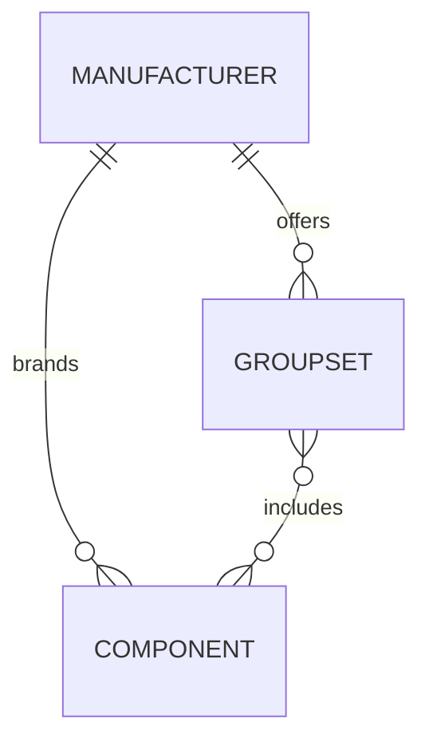

# Catalogue and UI foundation

The browsing hierarchy is **manufacturer → groupset → component**. Catalogue records live in Git and feed generated static pages and search. User photos/comments remain in R2/D1 and reference stable component IDs.

Before contributing weights, read the [component weight guidelines](weights-guidelines.md) for the required configurations, inclusions and exclusions. Existing source notes below describe historical records, including entries awaiting correction to meet those standards.

Tailwind CSS is the chosen UI styling system. Astro generates the frontend and compiles pinned Tailwind into static CSS served by Cloudflare; npm dependencies are locked. Use semantic HTML, keyboard-visible focus, responsive layouts, and accessible labels. Keep Tailwind class names in source code or explicit mappings so the build can discover them; do not construct utility class names from arbitrary catalogue values. No runtime CSS CDN is required.

See the [colour and theme guide](design.md) for semantic colour tokens, the dark-mode toggle and contrast requirements.

## Hierarchy and storage



The hierarchy describes navigation. Records are stored once and linked by ID so a component shared by multiple groupsets retains one identity, photo collection, and comment history.

```text
data/
├── manufacturers/<manufacturer-id>.json
├── groupsets/<groupset-id>.json
├── components/<component-id>.json
└── schemas/
    ├── catalogue.schema.json
    └── component-type.schema.json
```

- A manufacturer record represents the catalogue brand, not necessarily the physical factory that produced the part.
- A groupset references its manufacturer through `manufacturer_id`. Use a separate groupset record for a distinct generation where appropriate.
- A component references its manufacturer and one or more `groupset_ids`. Associated groupsets must have the same catalogue manufacturer. Compatibility with another manufacturer's products is a separate claim, not groupset membership.
- `groupset_ids` is the sole source of membership; do not maintain a second mirrored list on groupset records.
- IDs are globally unique, stable lowercase identifiers. Filenames match IDs. Slugs and display names can change independently; renaming them must not change community references. Manufacturer slugs are unique; groupset/component slugs are unique within their manufacturer.
- Components can have multiple variants of the same type within one groupset. Distinct identifiable variants can have distinct IDs; do not assume one record per category.

Component hyperlinks use the model number as their entire link text in catalogue results and groupset lists; the manufacturer and descriptive name remain adjacent, unlinked supporting text. Descriptions remain searchable. Component pages use the model number as the primary heading, with the component name below it, readable Sources/Component details headings, and a compact definition list for specifications. Breadcrumbs, group headings, cards and memberships use the same groupset name and model number (for example, “105 R7000”). Internal reference IDs are kept in the data rather than displayed as micro-labels. Only external links show an arrow; they open in a new tab and include “(opens in new tab)” in their accessible name. Internal links stay in the same tab. Pages offer manufacturer/group breadcrumbs, component-type filtering, and component details. Resolve navigation through the references. Shared components need a consistent canonical URL and stable identity across groupset browsing contexts. Canonical component URLs are `/components/<manufacturer-slug>/<component-slug>/`, independent of groupset context. Groupsets use `/groupsets/<manufacturer-slug>/<groupset-slug>/`; manufacturers use `/manufacturers/<slug>/`. Slug changes still need explicit redirects.

## Required component and groupset details

Every component must have a non-empty `model_number`, a `weight_g` field, a non-empty `weight_description`, and a `technical_document` citation (`url`, `title`, optional `retrieved_on`). Known weights are positive numbers in grams. Any component without a sourced weight for a configuration that meets the [weight guidelines](weights-guidelines.md) must use explicit `weight_g: null`; the page displays “Not yet sourced” and the search index preserves null. `weight_description` explains why the weight is unavailable. Never substitute zero, omit the field or invent a value. The previous optional `model_code` is replaced by `model_number`; existing stable IDs and canonical URLs are unchanged.

The weight description identifies the weighed configuration: crank length and chainring teeth, cassette sprocket range, derailleur cage length, pedal pair versus single pedal, or hub dimensions/variant as relevant. Distinguish manufacturer average weights from measurements and record exclusions. The starter Shimano weights are manufacturer averages, with a linked handbook and PDF page for each component. A model-wide record may cite one explicitly identified reference configuration; do not imply the same weight applies to every option or silently change the record's identity into a different variant.

**All front and rear hub weights exclude skewers.** Hub records additionally require `weight_excludes_skewers: true`; false/missing values fail validation. Include the hub's identifying configuration in `weight_description` and ensure the source supports the weight without skewers. Do not copy a skewer-inclusive weight or estimate an undocumented skewer deduction. The UI states the exclusion beside a known hub weight. For a rear hub with unknown weight, the flag expresses the requirement for a future weight, and the UI says “Any weight added must exclude skewers.”

Each manufacturer declares an official `website_url`. Technical documents must use HTTPS on that hostname (ignoring a leading `www.`) or one of its subdomains. Retailer/mirror domains, lookalike suffixes and credential-bearing URLs are rejected. Contributor review must verify domain ownership, that the document covers the exact component, and that the cited page supports the weight/description; offline validation cannot establish these facts. Manufacturer-owned specification pages or PDFs are valid; a generic homepage is not a technical specification. External CDNs need an explicit future ownership/validation design rather than weakening this rule.

Every groupset requires a non-empty `model_number` and `year_range: {"start": <year>, "end": <year or null>}`. Start is the documented introduction/availability year, not an inferred marketing model year. A known end is inclusive and cannot precede start. Null end means **end year not documented**, not proof that production continues. The UI uses that wording rather than “present”. The old `introduced_year` is replaced by this single range. Optional `generation` remains a descriptive label, separate from the manufacturer's model number.

## Component types

The ordered [component-type schema](../data/schemas/component-type.schema.json) is the single source for valid IDs and UI labels. Its `oneOf` entries provide `const` and `title`; the catalogue schema references it directly.

| Stable type ID | UI label |
| --- | --- |
| `crankset` | Crankset |
| `bottom-bracket` | Bottom Bracket |
| `front-derailleur` | Front Derailleur |
| `rear-derailleur` | Rear Derailleur |
| `shifters` | Shifters |
| `cassette` | Cassettes |
| `headset` | Headset |
| `seatpost` | Seatpost |
| `pedals` | Pedals |
| `front-hub` | Front Hub |
| `rear-hub` | Rear Hub |

These are the initial categories. A groupset need not contain all eleven, and membership must be sourced rather than inferred. In the UI, a missing category means **not yet catalogued**, not proof that the manufacturer never offered it. Additional categories can be added through a schema/documentation change without renaming existing IDs.

## Record examples

These examples are deliberately fictional and show the contract, not bicycle specifications to publish.

Manufacturer, saved as `data/manufacturers/example-maker.json`:

```json
{
  "id": "example-maker",
  "slug": "example-maker",
  "name": "Example Manufacturer",
  "website_url": "https://example.com/",
  "sources": [{"url": "https://example.com/catalogue", "title": "Example catalogue"}]
}
```

Groupset, saved as `data/groupsets/example-group.json`:

```json
{
  "id": "example-group",
  "slug": "example-road-first-generation",
  "name": "Example Road",
  "manufacturer_id": "example-maker",
  "generation": "First generation",
  "model_number": "ER-100",
  "year_range": {"start": 2000, "end": null},
  "sources": [{"url": "https://example.com/catalogue", "title": "Example catalogue"}]
}
```

Component, saved as `data/components/example-crankset.json`:

```json
{
  "id": "example-crankset",
  "slug": "example-crankset",
  "name": "Example Crankset",
  "manufacturer_id": "example-maker",
  "groupset_ids": ["example-group"],
  "type": "crankset",
  "model_number": "EC-100",
  "weight_g": 500,
  "weight_description": "170 mm crank arms, 50/34T chainrings; excludes bottom bracket",
  "technical_document": {"url": "https://docs.example.com/specification.pdf", "title": "Example manufacturer technical specification"},
  "specifications": {"crank_length_mm": 170, "chainrings_teeth": [50, 34], "includes_bottom_bracket": false},
  "sources": [{"url": "https://example.com/catalogue", "title": "Example catalogue"}]
}
```

Every record needs a non-empty source list. Use HTTP(S) URLs and descriptive titles; `retrieved_on` is an optional ISO date. Schema checks validate citation structure/URL syntax offline, not page availability or the truth of a specification. Reviewers must assess evidence, attribution, and permission to contribute it.

Unknown optional information should be omitted or `null`, never invented. Specification keys use lowercase underscores and explicit units where applicable, such as `crank_length_mm` or `chainline_mm`. Values can be scalars or lists of scalars. Known weights additionally require the type-specific reference fields listed in the [weight guide](weights-guidelines.md#validation-fields). These identify the weighed configuration, rather than every option sold under a model number. Do not treat flexible specification fields as a substitute for sourced facts.

## Validation and current status

From the repository root:

```sh
python3 -m pip install -r scripts/requirements-catalogue.txt
python3 scripts/check_catalogue.py
```

CI validates JSON Schema 2020-12 contracts, known component types, required fields/sources, duplicate JSON keys, globally unique IDs, filename/ID agreement, scoped slugs, and manufacturer/groupset references. Record directories are flat JSON directories; other formats and nested record directories are rejected. Empty directories are valid during initial setup. The catalogue contains 17 Shimano groupsets and 155 unique components. Alongside [all nine Shimano 105 generations](shimano-105.md), Exage 500EX A500 and RX100 A550, it includes [all five Ultegra series offered in 1990–2009](ultegra.md): 600 Ultegra 6400, 6500, 6600, Ultegra SL and 6700. Shared parts have multiple memberships and one identity. Series coverage does not imply every component variant is catalogued; the Ultegra guide documents dates, weights and remaining gaps.

The [catalogue schema](../data/schemas/catalogue.schema.json) validates an aggregate containing `manufacturers`, `groupsets`, and `components` arrays. The loader assembles it from individual files. The Astro static build consumes these records and the same taxonomy. It generates detail pages, a static search index, and a catalogue page with browser-side search/type/groupset filters. Search uses the generated page records without database calls. Unknown specifications remain omitted/null; community features are visibly marked as planned.

## Historical Shimano Exage 500EX

The road groupset is **Exage 500EX, A500 series**, distinct from the Exage 500LX mountain-bike group. Its record starts in **1989**, the first documented appearance in the evidence cited here: Shimano's *Dealers’ 1990 Product Manual*, published in August 1989. The cover's 1990 model year is not used as an inferred release date. This establishes a documented listing, not an exact retail launch date; the end year remains undocumented.

Original Shimano material is preserved by Disraeli Gears: [page 30 introduces the group](https://www.disraeligears.co.uk/site/shimano_-_dealers_1990_product_manual_-_page_30.html), [page 31 shows the group](https://www.disraeligears.co.uk/site/shimano_-_dealers_1990_product_manual_-_page_31.html), and [page 32 lists its components, configurations and weights](https://www.disraeligears.co.uk/site/shimano_-_dealers_1990_product_manual_-_page_32.html). These are manufacturer documents hosted by an independent archive. Component `sources` cite that specification page; each `technical_document` separately links to the relevant original exploded drawing on Shimano's own service site. Exploded drawings identify parts and variants; the dealer manual supplies the manufacturer-listed weights. The front hub instead uses a contributor-reported weight, cited in its component record.

| Component | Model | Weight and basis |
| --- | --- | --- |
| Crankset | FC-A500 | 720 g; 170 mm, 52/42T Biopace; bottom bracket separate |
| Bottom bracket | BB-A450 | 333 g; set with 113 mm spindle; weight's thread variant unspecified |
| Front derailleur | FD-A500-B | 115 g; band-on, 28.0–28.6 mm |
| Rear derailleur | RD-A500 | 279 g; double-chainset version, 28T total capacity |
| Shifters | SL-A500-FCAI | 76 g; seven-speed braze-on downtube lever set, M5 Italian-type bosses |
| Cassette | CS-HG50 | 268 g; seven-speed I group, 13–23T sprockets and spacers |
| Headset | HP-R500 | 121 g; 22/11.5 mm upper/lower cones; weight's thread variant unspecified |
| Pedals | PD-A550 | 407 g; pair including size L toe clips |
| Front hub | HB-RM50-F | 139 g; contributor measurement, 36-hole hub without skewer |
| Rear hub | FH-HG50 | Not yet sourced; weight without skewer required |

Except for the contributor-measured front hub and the rear hub with unknown weight, these are manufacturer-listed reference weights, not new measurements or claims about every available option. BB-A450, CS-HG50, HP-R500 and PD-A550 retain their own component identities; membership is documented by the group specification table, even where a service drawing labels a shared part as another series.

The manual lists FH-HG50 at 436 g **with quick release**; this number is not used. The rear hub is included with `weight_g: null`, pending a sourced weight without its skewer. Its Shimano drawing covers the seven-speed quick-release and nutted variants; the catalogue record describes the quick-release version listed in the group manual, without inferring axle dimensions from a later drawing. The HB-RM50-F front hub uses a contributor-reported weight because the manual's weight does not explicitly establish skewer exclusion. No seatpost is listed on that page. Brakes and the chain are outside the current component taxonomy; their absence from the catalogue does not imply absence from the original groupset.

## Historical Shimano RX100

The **RX100 A550** record covers the original seven-speed road group with downtube shifters. [Shimano's RX100 history](https://www.shimano.com/en/100th/history/products/result.html?id=50) dates its introduction to **1989** and describes later dual-control levers. The end year remains undocumented in this record. Later STI, triple-chainset and other revisions are not implied by the initial component list.

The original *Dealers’ 1990 Product Manual*, published in August 1989, provides the evidence: [page 26 introduces RX100](https://www.disraeligears.co.uk/site/shimano_-_dealers_1990_product_manual_-_page_26.html), [page 27 shows the group](https://www.disraeligears.co.uk/site/shimano_-_dealers_1990_product_manual_-_page_27.html), and [page 28 lists its components and weights](https://www.disraeligears.co.uk/site/shimano_-_dealers_1990_product_manual_-_page_28.html). These original Shimano scans are hosted by Disraeli Gears. Each component also links to its relevant technical drawing on Shimano's service site.

| Component | Model | Weight and basis |
| --- | --- | --- |
| Crankset | FC-A550 | 700 g; 170 mm, 52/42T double; bottom bracket separate |
| Bottom bracket | BB-A550 | 327 g; set with 113 mm spindle; weight's thread variant unspecified |
| Front derailleur | FD-A550-B | 100 g; band-on, 28.0–28.6 mm |
| Rear derailleur | RD-A550 | 280 g; double-chainset version, 28T total capacity |
| Shifters | SL-A550-FCAI | 72 g; seven-speed braze-on downtube lever set, M5 Italian-type bosses |
| Cassette | CS-HG70 | 325 g; seven-speed I group, 13–23T sprockets and spacers |
| Headset | HP-R500 | 121 g; shared with Exage 500EX |
| Pedals | PD-A550 | Shared record retains the Exage table's 407 g; RX100 table lists 400 g, both including size L toe clips |
| Rear hub | FH-A550 | Not yet sourced without skewer; seven-speed quick release, 126 mm over locknuts, 137 mm axle |

The two pedal weights conflict for the same nominal model/configuration. Preserve one component identity and the existing 407 g reference value, cite both tables and disclose the 400 g listing in the weight description. Do not average the values or invent a variant to explain the difference.

The FH-A550's published 420 g includes its quick release, so the catalogue uses an explicit unknown weight. The HB-A550-F front hub is not yet added: its 202 g listing does not explicitly establish skewer exclusion. The HB-RM50 measurement belongs to a different model and is not reused. The manual's cassette row names CS-HG70; its sidebar heading says CS-HG50. Membership follows the component row, with the seven-speed I-group tooth sequence confirmed by Shimano's shared CS-HG90/HG70/HG50 drawing. No seatpost is listed; brakes and the chain remain outside the current taxonomy.

## Rear derailleur limits and cage codes

Every `rear-derailleur` requires these keys inside `specifications`:

| Key | Display label | Known value |
| --- | --- | --- |
| `total_capacity_teeth` | Total capacity | Positive integer |
| `maximum_sprocket_teeth` | Largest sprocket | Positive integer |
| `minimum_sprocket_teeth` | Smallest sprocket | Positive integer |
| `maximum_front_difference_teeth` | Front chainring tooth difference | Non-negative integer |

Use explicit `null` when a limit has not been sourced; the page displays “Not yet sourced”. Known values display a `T` suffix. Smallest sprocket cannot exceed largest sprocket. Zero front difference is valid for a single-chainring configuration. Individual maxima need not be usable together: chain take-up is the front chainring difference plus the rear sprocket difference, and must remain within total capacity. Cite the exact model, cage variant and specification edition. See [Ultegra source notes](ultegra.md#rear-derailleur-limits) for the older Shimano records. Cassette sprocket limits do not apply to front derailleurs.

An optional `specifications.cage` records the manufacturer's sourced cage code. Do not infer a code from capacity alone. The shared [cage-help component](../apps/web/src/components/DerailleurCageHelp.astro) defines SS (short), GS (medium, sometimes called long), and LS/SGS (long) once for all rear derailleur pages. These names vary by manufacturer and do not replace model-specific limits. The explanation opens on hover, keyboard focus or tap, stays available while hovered/focused, and closes with Escape or an outside press. Without JavaScript it appears as ordinary text. Keep this explanation out of individual JSON records.

## Shimano 105 generation coverage

The catalogue includes all nine [Shimano 105 generations](shimano-105.md), represented by ten groupset records because R7100 mechanical and Di2 are distinct offerings. There are 82 105 component identities across 87 memberships, including the three original R7000 records; the expansion adds nine groupsets and 79 component identities. The whole catalogue now contains one manufacturer, 17 groupsets and 155 components. Shared current parts retain one canonical identity. See the source guide for dates, variants, weight configurations, exclusions and explicit unknowns. Generation coverage does not imply every component option is already catalogued.
