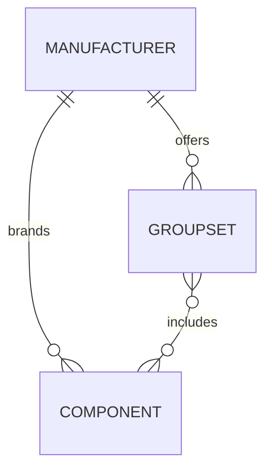

# Catalogue and UI foundation

The browsing hierarchy is **manufacturer → groupset → component**. Catalogue records live in Git and feed generated static pages and search. User photos/comments remain in R2/D1 and reference stable component IDs.

Tailwind CSS is the chosen UI styling system. The frontend has not been scaffolded yet; its build will compile Tailwind into static CSS served by Cloudflare. Pin the package version and lock dependencies when scaffolding the frontend. Use semantic HTML, keyboard-visible focus, responsive layouts, and accessible labels. Keep Tailwind class names in source code or explicit mappings so the build can discover them; do not construct utility class names from arbitrary catalogue values. No runtime CSS CDN is required.

## Hierarchy and storage



The hierarchy describes navigation. Records are stored once and linked by ID so a component shared by multiple groupsets retains one identity, photo collection, and comment history.

```text
data/
├── manufacturers/<manufacturer-id>.json
├── groupsets/<groupset-id>.json
├── components/<component-id>.json
└── schemas/
    ├── catalogue.schema.json
    └── component-type.schema.json
```

- A manufacturer record represents the catalogue brand, not necessarily the physical factory that produced the part.
- A groupset references its manufacturer through `manufacturer_id`. Use a separate groupset record for a distinct generation where appropriate.
- A component references its manufacturer and one or more `groupset_ids`. Associated groupsets must have the same catalogue manufacturer. Compatibility with another manufacturer's products is a separate claim, not groupset membership.
- `groupset_ids` is the sole source of membership; do not maintain a second mirrored list on groupset records.
- IDs are globally unique, stable lowercase identifiers. Filenames match IDs. Slugs and display names can change independently; renaming them must not change community references. Manufacturer slugs are unique; groupset/component slugs are unique within their manufacturer.
- Components can have multiple variants of the same type within one groupset. Distinct identifiable variants can have distinct IDs; do not assume one record per category.

Future pages should offer manufacturer/group breadcrumbs, component-type filtering, and component detail pages. Resolve navigation through the references. Shared components need a consistent canonical URL and stable identity across groupset browsing contexts; URL generation and redirects will be implemented with the frontend.

## Component types

The ordered [component-type schema](../data/schemas/component-type.schema.json) is the single source for valid IDs and UI labels. Its `oneOf` entries provide `const` and `title`; the catalogue schema references it directly.

| Stable type ID | UI label |
| --- | --- |
| `crankset` | Crankset |
| `bottom-bracket` | Bottom Bracket |
| `front-derailleur` | Front Derailleur |
| `rear-derailleur` | Rear Derailleur |
| `shifters` | Shifters |
| `cassette` | Cassettes |
| `headset` | Headset |
| `seatpost` | Seatpost |
| `pedals` | Pedals |
| `front-hub` | Front Hub |
| `rear-hub` | Rear Hub |

These are the initial categories. A groupset need not contain all eleven, and membership must be sourced rather than inferred. In the future UI, a missing category means **not yet catalogued**, not proof that the manufacturer never offered it. Additional categories can be added through a schema/documentation change without renaming existing IDs.

## Record examples

These examples are deliberately fictional and show the contract, not bicycle specifications to publish.

Manufacturer, saved as `data/manufacturers/example-maker.json`:

```json
{
  "id": "example-maker",
  "slug": "example-maker",
  "name": "Example Manufacturer",
  "sources": [{"url": "https://example.com/catalogue", "title": "Example catalogue"}]
}
```

Groupset, saved as `data/groupsets/example-group.json`:

```json
{
  "id": "example-group",
  "slug": "example-road-first-generation",
  "name": "Example Road",
  "manufacturer_id": "example-maker",
  "generation": "First generation",
  "introduced_year": null,
  "sources": [{"url": "https://example.com/catalogue", "title": "Example catalogue"}]
}
```

Component, saved as `data/components/example-crankset.json`:

```json
{
  "id": "example-crankset",
  "slug": "example-crankset",
  "name": "Example Crankset",
  "manufacturer_id": "example-maker",
  "groupset_ids": ["example-group"],
  "type": "crankset",
  "model_code": null,
  "specifications": {"weight_g": null},
  "sources": [{"url": "https://example.com/catalogue", "title": "Example catalogue"}]
}
```

Every record needs a non-empty source list. Use HTTP(S) URLs and descriptive titles; `retrieved_on` is an optional ISO date. Schema checks validate citation structure/URL syntax offline, not page availability or the truth of a specification. Reviewers must assess evidence, attribution, and permission to contribute it.

Unknown optional information should be omitted or `null`, never invented. Specification keys use lowercase underscores and explicit units where applicable, such as `crank_length_mm` or `weight_g`. Values can be scalars or lists of scalars; type-specific specification contracts can be tightened later. Do not treat flexible specification fields as a substitute for sourced facts.

## Validation and current status

From the repository root:

```sh
python3 -m pip install -r scripts/requirements-catalogue.txt
python3 scripts/check_catalogue.py
```

CI validates JSON Schema 2020-12 contracts, known component types, required fields/sources, duplicate JSON keys, globally unique IDs, filename/ID agreement, scoped slugs, and manufacturer/groupset references. Record directories are flat JSON directories; other formats and nested record directories are rejected. Empty directories are valid during initial setup. No real manufacturer/groupset/component records have been added yet.

The [catalogue schema](../data/schemas/catalogue.schema.json) validates an aggregate containing `manufacturers`, `groupsets`, and `components` arrays. The loader assembles it from individual files. The frontend/static build will consume these records and the same taxonomy; Tailwind integration, generated routes, search, and application shared types are future implementation work.
